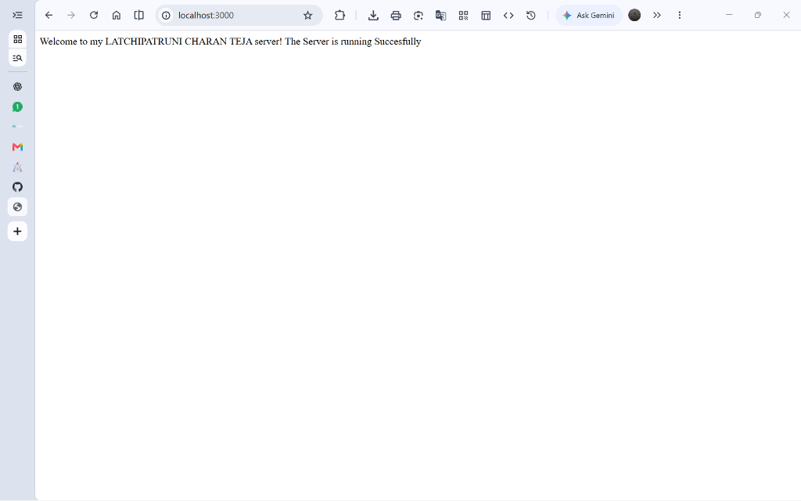
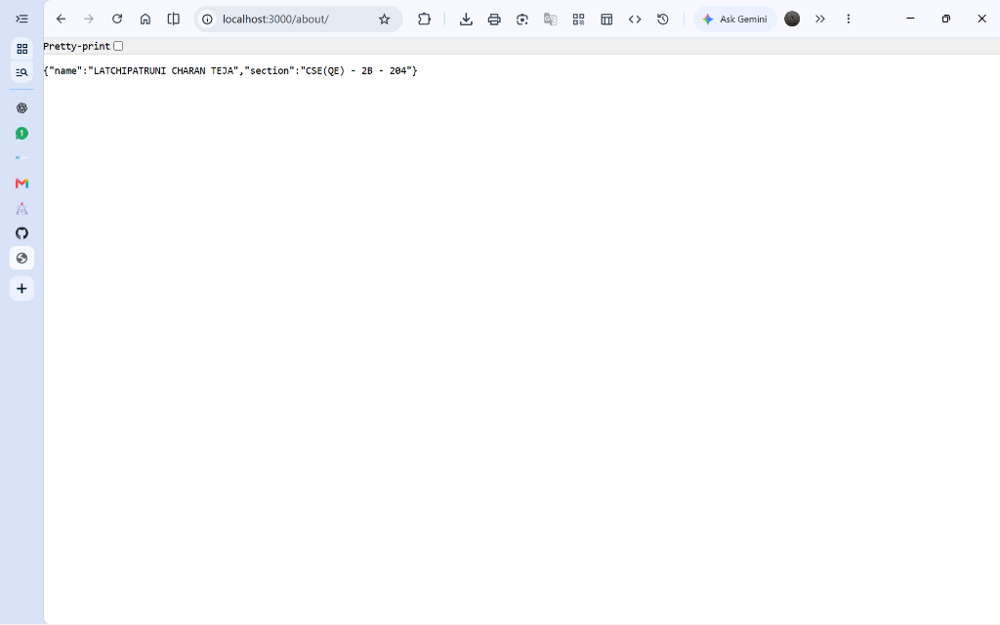
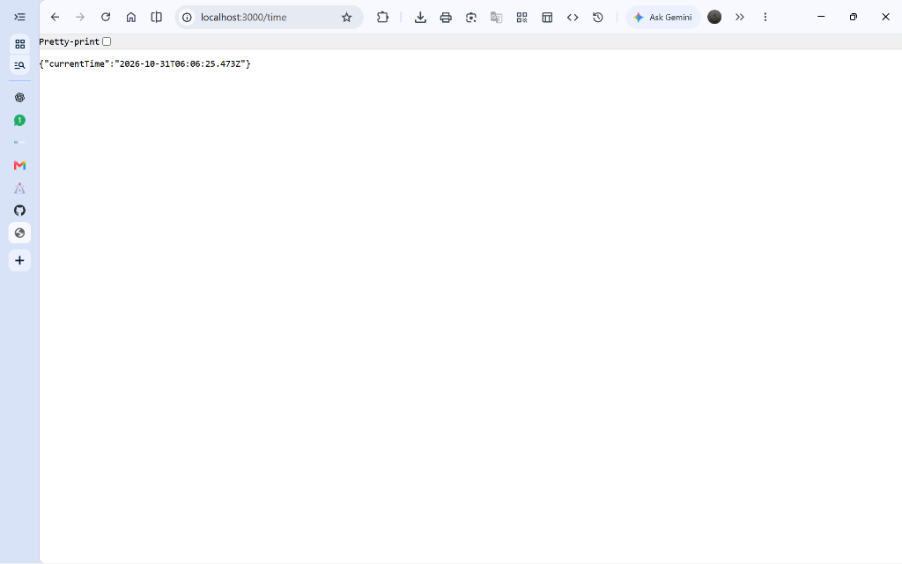
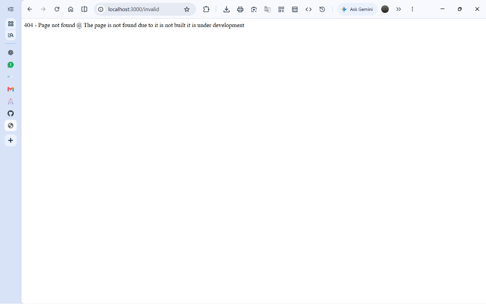

# Lab 01: Node.js and Express Server

## Student Details

- **Name:** LATCHIPATRUNI CHARAN TEJA
- **Registration Number:** 252U1R8045
- **Section:** CSE(QE)-2B - 204

**Deployed link:** https://backend-development-fundamentals-62ec.onrender.com

## Objective

To create a basic HTTP server using Node.js and build a web server using Express.js with multiple routes and proper HTTP status codes.

## Technologies Used

- Node.js
- Express.js
- JavaScript
- Visual Studio Code

## Installation and Setup

1. Initialize the Node.js project:

   ```bash
   npm init -y
   ```

2. Install Express:

   ```bash
   npm install express
   ```

## How to Run

### Node.js HTTP Server

Run the following command:

```bash
node plain-server.js
```

### Express Server

Run the following command:

```bash
npm start
# or
node app.js
```

## API Endpoints

- **GET /** — Displays the welcome message.
- **GET /about** — Returns student name and section as JSON.
- **GET /time** — Returns the current date and time.
- **GET /invalid** — Returns a 404 Page Not Found response.

## Screenshots

### Home Page



### About Page



### Time Page



### Not Found Page



## Notes

- `package.json` contains project information and dependencies.
- `node_modules` contains the installed packages.
- The Node.js built-in `http` module is used for the plain server.
- Express.js is used to handle routes and HTTP responses.
